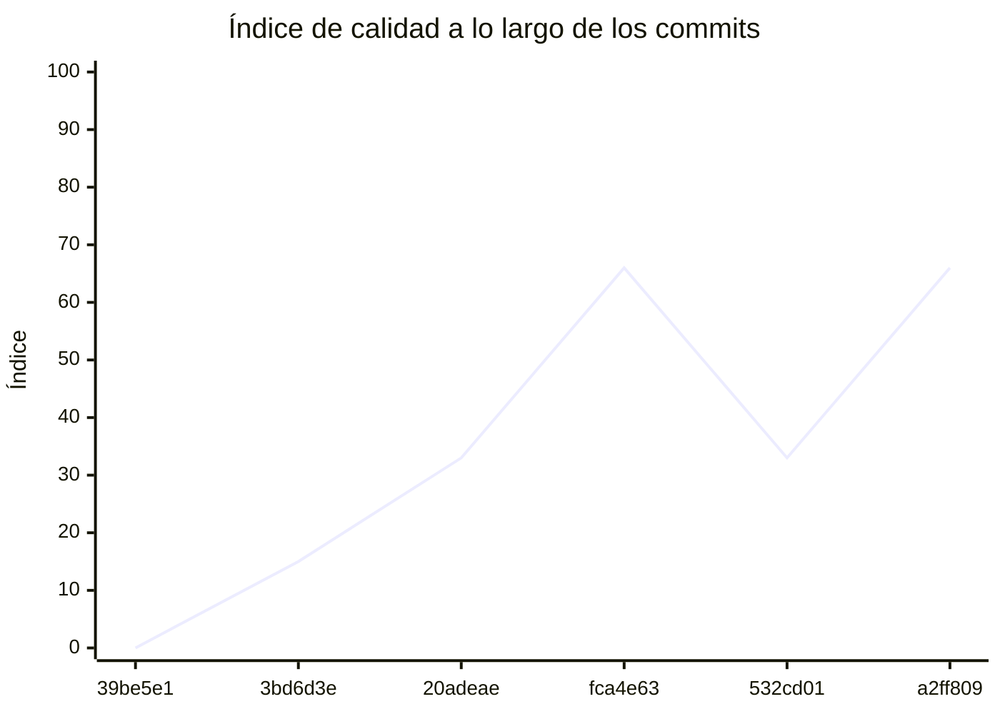

<!-- evaluacion:inicio -->
# Evaluación — prog2rupcic/backend-turnos

> Documento **generado automáticamente** por la cátedra de Programación II (UM): RepoSense + análisis de calidad de **7 dimensiones**. **No editar a mano**: se regenera en cada evaluación.
> Rama evaluada: `main`. Análisis **heurístico** (regex + métricas) + build: es una criba para orientar la revisión, **no una nota**. La **documentación** del repositorio no se evalúa.
> Generado: 2026-11-20.

## 1. Veredicto

| Aspecto | Resultado |
|---|---|
| Índice de calidad | **77/100** |
| Tipo de repositorio | `backend` |
| Build (`mvnw verify` / `gradlew check`) | OK |
| Código (LOC) | 8,534 |
| Archivos de código | 177 |
| Clases | 217 |
| Código dentro de clases (%POO) | 78% |
| Funciones fuera de clases | 0 |
| Duplicación (puerta) | 1.6% |
| Duplicación lógica | 1.7% |
| Duplicación de boilerplate | 9.6% |
| Cobertura | 96% |
| Tope duro aplicado a D1 | `POO_BAJO` → D1 ≤ 60 |

> Este informe **describe** lo que el análisis midió con los criterios ya establecidos de la materia. No es una nota.

## 2. Semáforo de aprobación

Criterios de la cátedra (`CRITERIOS-CALIDAD.md`): **Aprobar** se juega con el perfil `estandar`; **destacar**, con el `exigente` (meta de excelencia).

| Semáforo | Resultado |
|---|---|
| Aprobar (`estandar`) | **no cumple** — 7/11 |
| Destacar (`exigente`) | **no cumple** — 5/11 |

**Para aprobar, falta cumplir:** SOLID

**Para destacar, falta cumplir:** SOLID; POO; Duplicación

## 3. Autoría (RepoSense)

| Autor | Commits | Código (LOC) | Tests (LOC) | Docs (LOC) | Días activos | % del código |
|---|---:|---:|---:|---:|---:|---:|
| Juan Cruz Rupcic | 21 | 4,499 | 5,300 | 327 | 15 | 100% |

> _El LOC de autoría lo calcula RepoSense sobre el historial y puede diferir del LOC de código del análisis (que mira el estado de `main`)._

## 4. Dimensiones evaluadas

Cada dimensión indica **qué mide**, **por qué importa** y **tu resultado**. Cuando el puntaje queda por debajo de la referencia, se agregan preguntas para **investigar la causa** (no hay recetas).

| Dimensión | Peso | Puntaje |
|:--|--:|--:|
| **D1** Diseño OO, SOLID y patrones (20%) | 20% | 2 |
| **D2** Arquitectura hexagonal — backend (15%) | 15% | 100 |
| **D3** Frontend KMP: MVVM y buenas prácticas (10%) | 10% | N/A |
| **D4** Integración y contrato (10%) | 10% | 90 |
| **D5** Seguridad y robustez (10%) | 10% | 100 |
| **D6** Pruebas y cobertura (20%) | 20% | 100 |
| **D7** Proceso y entrega (15%) | 15% | 100 |

### D1. Diseño OO, SOLID y patrones (20%)

- **Qué mide:** Métricas orientadas a objetos (clases, métodos, campos, cohesión, acoplamiento, herencia) y proxies de SOLID, más patrones de diseño.
- **Por qué importa:** El eje de la materia es el buen uso de la POO y su arquitectura: un diseño con clases claras y poco acopladas es más fácil de entender, probar y cambiar.
- **Tu resultado:** **2/100**
- **Para investigar la causa:**
    - ¿Se pensó el modelo de clases antes de codificar o se agrupó después?
    - ¿Qué clases concentran muchas responsabilidades a la vez?
    - ¿Los colaboradores llegan como parámetros o se crean por dentro?

### D2. Arquitectura hexagonal — backend (15%)

- **Qué mide:** Separación en capas (dominio, puertos de entrada/salida, adaptadores) y dirección de las dependencias del backend.
- **Por qué importa:** Aislar el dominio de la infraestructura permite cambiar la base de datos, el framework o el transporte sin tocar las reglas de negocio.
- **Tu resultado:** **100/100**

### D4. Integración y contrato (10%)

- **Qué mide:** Cumplimiento del contrato de integración de la cátedra (formato de errores, paginación, autenticación, endpoints esperados).
- **Por qué importa:** Los servicios deben poder integrarse entre sí y con la app sin sorpresas; el contrato es lo que hacen cumplir las pruebas de integración.
- **Tu resultado:** **90/100**

### D5. Seguridad y robustez (10%)

- **Qué mide:** Credenciales embebidas, consultas SQL por concatenación, y presencia de config de entorno; aislamiento de secretos.
- **Por qué importa:** Un secreto en el repositorio o una consulta construida por concatenación son riesgos concretos, no hipotéticos.
- **Tu resultado:** **100/100**

### D6. Pruebas y cobertura (20%)

- **Qué mide:** Cantidad y resultado de pruebas y cobertura de línea (JaCoCo/Kover, Surefire/Failsafe) cuando hay build.
- **Por qué importa:** Las pruebas son la red de seguridad para refactorizar e integrar; la cobertura acota las zonas sin verificar.
- **Tu resultado:** **100/100**

### D7. Proceso y entrega (15%)

- **Qué mide:** Artefactos verificables de proceso/entrega: `compose`, `.env.example`, CI (`.github/workflows/`), `CODEOWNERS` y wrapper de build (`mvnw`/`gradlew`). **No** puntúa documentación.
- **Por qué importa:** Un proyecto que compila, se levanta y se valida solo es más fácil de revisar y de integrar en equipo.
- **Tu resultado:** **100/100**

## 5. Señales detectadas

El análisis encontró las siguientes señales, con el archivo y la línea donde se originan cuando están disponibles:

**Archivos con más señales**

| Archivo | Señales |
|---|---:|
| `src/main/java/ar/edu/turnos/turnos/reservation/domain/model/ReservationProcess.java` | 8 |
| `src/main/java/ar/edu/turnos/turnos/reservation/infrastructure/rest/CatedraReservationsRestAdapter.java` | 7 |
| `src/main/java/ar/edu/turnos/turnos/reservation/infrastructure/kafka/PhoneResultParser.java` | 7 |
| `src/main/java/ar/edu/turnos/turnos/reservation/infrastructure/persistence/adapter/JdbcPhoneExchangeRepositoryAdapter.java` | 6 |
| `src/main/java/ar/edu/turnos/turnos/reservation/application/usecases/RecoverPendingUseCaseImpl.java` | 6 |
| `src/main/java/ar/edu/turnos/turnos/reservation/infrastructure/rest/CatedraHoldRestAdapter.java` | 5 |
| `src/main/java/ar/edu/turnos/turnos/reservation/infrastructure/kafka/AdditionalInformationRequestParser.java` | 5 |
| `src/main/java/ar/edu/turnos/turnos/reservation/application/usecases/CreateHoldUseCaseImpl.java` | 5 |
| `src/main/java/ar/edu/turnos/turnos/reservation/application/usecases/ConfirmHoldUseCaseImpl.java` | 5 |
| `src/main/java/ar/edu/turnos/turnos/reservation/application/usecases/ListOwnReservationsUseCaseImpl.java` | 5 |

**SRP/responsabilidad** (87)
- método 'IsSlotAvailableUseCaseImpl.check' con complejidad 7 — `src/main/java/ar/edu/turnos/turnos/availability/application/usecases/IsSlotAvailableUseCaseImpl.java:20`
- clase 'AvailabilityCalculator' grande (LOC=58, métodos=11, campos=0) — `src/main/java/ar/edu/turnos/turnos/availability/domain/model/AvailabilityCalculator.java:10`
- método 'AvailabilityCalculator.addSlots' con 5 parámetros — `src/main/java/ar/edu/turnos/turnos/availability/domain/model/AvailabilityCalculator.java:46`
- método 'CatalogAgendaRestAdapter.get' de 31 líneas — `src/main/java/ar/edu/turnos/turnos/availability/infrastructure/rest/CatalogAgendaRestAdapter.java:37`
- método 'CatalogAgendaRestAdapter.get' con complejidad 7 — `src/main/java/ar/edu/turnos/turnos/availability/infrastructure/rest/CatalogAgendaRestAdapter.java:37`
- método 'CatedraOccupancyRestAdapter.find' con complejidad 6 — `src/main/java/ar/edu/turnos/turnos/availability/infrastructure/rest/CatedraOccupancyRestAdapter.java:36`
- clase 'SecurityConfiguration' con baja cohesión (0%) — `src/main/java/ar/edu/turnos/turnos/config/SecurityConfiguration.java:31`
- clase 'ApplyRecoveryUseCaseImpl' grande (LOC=101, métodos=13, campos=4) — `src/main/java/ar/edu/turnos/turnos/reservation/application/usecases/ApplyRecoveryUseCaseImpl.java:17`
- método 'ApplyRecoveryUseCaseImpl.remote' de 63 líneas — `src/main/java/ar/edu/turnos/turnos/reservation/application/usecases/ApplyRecoveryUseCaseImpl.java:33`
- método 'ApplyRecoveryUseCaseImpl.remote' con complejidad 13 — `src/main/java/ar/edu/turnos/turnos/reservation/application/usecases/ApplyRecoveryUseCaseImpl.java:33`
- clase 'CancellationProgressUseCaseImpl' grande (LOC=62, métodos=10, campos=3) — `src/main/java/ar/edu/turnos/turnos/reservation/application/usecases/CancellationProgressUseCaseImpl.java:14`
- clase 'CancellationProgressUseCaseImpl' con baja cohesión (22%) — `src/main/java/ar/edu/turnos/turnos/reservation/application/usecases/CancellationProgressUseCaseImpl.java:14`
- clase 'ConfirmHoldUseCaseImpl' con baja cohesión (29%) — `src/main/java/ar/edu/turnos/turnos/reservation/application/usecases/ConfirmHoldUseCaseImpl.java:16`
- método 'ConfirmHoldUseCaseImpl.confirm' de 46 líneas — `src/main/java/ar/edu/turnos/turnos/reservation/application/usecases/ConfirmHoldUseCaseImpl.java:32`
- método 'ConfirmHoldUseCaseImpl.confirm' con complejidad 10 — `src/main/java/ar/edu/turnos/turnos/reservation/application/usecases/ConfirmHoldUseCaseImpl.java:32`
- método 'CreateHoldUseCaseImpl.create' de 37 líneas — `src/main/java/ar/edu/turnos/turnos/reservation/application/usecases/CreateHoldUseCaseImpl.java:33`
- método 'CreateHoldUseCaseImpl.create' con complejidad 6 — `src/main/java/ar/edu/turnos/turnos/reservation/application/usecases/CreateHoldUseCaseImpl.java:33`
- clase 'ListOwnReservationsUseCaseImpl' con baja cohesión (20%) — `src/main/java/ar/edu/turnos/turnos/reservation/application/usecases/ListOwnReservationsUseCaseImpl.java:14`
- método 'ListOwnReservationsUseCaseImpl.list' de 39 líneas — `src/main/java/ar/edu/turnos/turnos/reservation/application/usecases/ListOwnReservationsUseCaseImpl.java:26`
- método 'ListOwnReservationsUseCaseImpl.list' con complejidad 7 — `src/main/java/ar/edu/turnos/turnos/reservation/application/usecases/ListOwnReservationsUseCaseImpl.java:26`
- clase 'RecordCancellationUseCaseImpl' con baja cohesión (0%) — `src/main/java/ar/edu/turnos/turnos/reservation/application/usecases/RecordCancellationUseCaseImpl.java:14`
- clase 'RecordPhoneRequestUseCaseImpl' con baja cohesión (0%) — `src/main/java/ar/edu/turnos/turnos/reservation/application/usecases/RecordPhoneRequestUseCaseImpl.java:16`
- clase 'RecordPhoneResultUseCaseImpl' grande (LOC=51, métodos=11, campos=3) — `src/main/java/ar/edu/turnos/turnos/reservation/application/usecases/RecordPhoneResultUseCaseImpl.java:15`
- clase 'RecordPhoneResultUseCaseImpl' con baja cohesión (0%) — `src/main/java/ar/edu/turnos/turnos/reservation/application/usecases/RecordPhoneResultUseCaseImpl.java:15`
- clase 'RecoverPendingUseCaseImpl' grande (LOC=123, métodos=10, campos=9) — `src/main/java/ar/edu/turnos/turnos/reservation/application/usecases/RecoverPendingUseCaseImpl.java:21`
- método 'RecoverPendingUseCaseImpl.RecoverPendingUseCaseImpl' con 8 parámetros — `src/main/java/ar/edu/turnos/turnos/reservation/application/usecases/RecoverPendingUseCaseImpl.java:32`
- método 'RecoverPendingUseCaseImpl.knownProcess' con complejidad 6 — `src/main/java/ar/edu/turnos/turnos/reservation/application/usecases/RecoverPendingUseCaseImpl.java:79`
- método 'RecoverPendingUseCaseImpl.unknownHold' de 39 líneas — `src/main/java/ar/edu/turnos/turnos/reservation/application/usecases/RecoverPendingUseCaseImpl.java:108`
- método 'RecoverPendingUseCaseImpl.unknownHold' con complejidad 9 — `src/main/java/ar/edu/turnos/turnos/reservation/application/usecases/RecoverPendingUseCaseImpl.java:108`
- método 'SubmitPhoneUseCaseImpl.SubmitPhoneUseCaseImpl' con 5 parámetros — `src/main/java/ar/edu/turnos/turnos/reservation/application/usecases/SubmitPhoneUseCaseImpl.java:25`
- método 'SubmitPhoneUseCaseImpl.submit' de 36 líneas — `src/main/java/ar/edu/turnos/turnos/reservation/application/usecases/SubmitPhoneUseCaseImpl.java:36`
- método 'SubmitPhoneUseCaseImpl.submit' con complejidad 8 — `src/main/java/ar/edu/turnos/turnos/reservation/application/usecases/SubmitPhoneUseCaseImpl.java:36`
- método 'AdditionalInformationRequest.AdditionalInformationRequest' con 7 parámetros — `src/main/java/ar/edu/turnos/turnos/reservation/domain/model/AdditionalInformationRequest.java:5`
- método 'CancellationNotice.CancellationNotice' con 10 parámetros — `src/main/java/ar/edu/turnos/turnos/reservation/domain/model/CancellationNotice.java:7`
- método 'OwnReservation.OwnReservation' con 12 parámetros — `src/main/java/ar/edu/turnos/turnos/reservation/domain/model/OwnReservation.java:7`
- método 'PhoneResult.PhoneResult' con 14 parámetros — `src/main/java/ar/edu/turnos/turnos/reservation/domain/model/PhoneResult.java:7`
- método 'PhoneResult.PhoneResult' con 13 parámetros — `src/main/java/ar/edu/turnos/turnos/reservation/domain/model/PhoneResult.java:13`
- método 'PhoneSubmission.PhoneSubmission' con 11 parámetros — `src/main/java/ar/edu/turnos/turnos/reservation/domain/model/PhoneSubmission.java:5`
- método 'RecoveryProgress.RecoveryProgress' con 7 parámetros — `src/main/java/ar/edu/turnos/turnos/reservation/domain/model/RecoveryProgress.java:5`
- clase 'ReservationProcess' grande (LOC=95, métodos=14, campos=0) — `src/main/java/ar/edu/turnos/turnos/reservation/domain/model/ReservationProcess.java:7`
- método 'ReservationProcess.ReservationProcess' de 95 líneas — `src/main/java/ar/edu/turnos/turnos/reservation/domain/model/ReservationProcess.java:7`
- método 'ReservationProcess.ReservationProcess' con 21 parámetros — `src/main/java/ar/edu/turnos/turnos/reservation/domain/model/ReservationProcess.java:7`
- método 'ReservationProcess.ReservationProcess' con 19 parámetros — `src/main/java/ar/edu/turnos/turnos/reservation/domain/model/ReservationProcess.java:13`
- método 'ReservationProcess.ReservationProcess' con 15 parámetros — `src/main/java/ar/edu/turnos/turnos/reservation/domain/model/ReservationProcess.java:22`
- método 'SlotAvailabilityAdapter.isAvailable' con complejidad 7 — `src/main/java/ar/edu/turnos/turnos/reservation/infrastructure/availability/SlotAvailabilityAdapter.java:19`
- método 'AdditionalInformationRequestListener.AdditionalInformationRequestListener' con 6 parámetros — `src/main/java/ar/edu/turnos/turnos/reservation/infrastructure/kafka/AdditionalInformationRequestListener.java:27`
- clase 'AdditionalInformationRequestParser' con baja cohesión (0%) — `src/main/java/ar/edu/turnos/turnos/reservation/infrastructure/kafka/AdditionalInformationRequestParser.java:12`
- método 'AdditionalInformationRequestParser.parse' con complejidad 7 — `src/main/java/ar/edu/turnos/turnos/reservation/infrastructure/kafka/AdditionalInformationRequestParser.java:19`
- método 'AdditionalInformationRequestParser.Payload' con 9 parámetros — `src/main/java/ar/edu/turnos/turnos/reservation/infrastructure/kafka/AdditionalInformationRequestParser.java:80`
- método 'Payload.Payload' con 9 parámetros — `src/main/java/ar/edu/turnos/turnos/reservation/infrastructure/kafka/AdditionalInformationRequestParser.java:80`
- clase 'CancellationNoticeParser' grande (LOC=33, métodos=14, campos=2) — `src/main/java/ar/edu/turnos/turnos/reservation/infrastructure/kafka/CancellationNoticeParser.java:13`
- método 'CancellationNoticeParser.Payload' con 14 parámetros — `src/main/java/ar/edu/turnos/turnos/reservation/infrastructure/kafka/CancellationNoticeParser.java:45`
- método 'Payload.Payload' con 14 parámetros — `src/main/java/ar/edu/turnos/turnos/reservation/infrastructure/kafka/CancellationNoticeParser.java:45`
- clase 'PhoneResultParser' grande (LOC=56, métodos=11, campos=2) — `src/main/java/ar/edu/turnos/turnos/reservation/infrastructure/kafka/PhoneResultParser.java:13`
- método 'PhoneResultParser.parse' de 38 líneas — `src/main/java/ar/edu/turnos/turnos/reservation/infrastructure/kafka/PhoneResultParser.java:23`
- método 'PhoneResultParser.parse' con complejidad 9 — `src/main/java/ar/edu/turnos/turnos/reservation/infrastructure/kafka/PhoneResultParser.java:23`
- método 'PhoneResultParser.Payload' con 16 parámetros — `src/main/java/ar/edu/turnos/turnos/reservation/infrastructure/kafka/PhoneResultParser.java:70`
- método 'Payload.Payload' con 16 parámetros — `src/main/java/ar/edu/turnos/turnos/reservation/infrastructure/kafka/PhoneResultParser.java:70`
- clase 'JdbcPhoneExchangeRepositoryAdapter' grande (LOC=108, métodos=13, campos=1) — `src/main/java/ar/edu/turnos/turnos/reservation/infrastructure/persistence/adapter/JdbcPhoneExchangeRepositoryAdapter.java:15`
- método 'JdbcPhoneExchangeRepositoryAdapter.enqueue' con complejidad 11 — `src/main/java/ar/edu/turnos/turnos/reservation/infrastructure/persistence/adapter/JdbcPhoneExchangeRepositoryAdapter.java:43`
- método 'JdbcPhoneExchangeRepositoryAdapter.claim' con complejidad 6 — `src/main/java/ar/edu/turnos/turnos/reservation/infrastructure/persistence/adapter/JdbcPhoneExchangeRepositoryAdapter.java:64`
- método 'JdbcPhoneExchangeRepositoryAdapter.published' con complejidad 6 — `src/main/java/ar/edu/turnos/turnos/reservation/infrastructure/persistence/adapter/JdbcPhoneExchangeRepositoryAdapter.java:87`
- método 'JdbcPhoneExchangeRepositoryAdapter.update' con complejidad 6 — `src/main/java/ar/edu/turnos/turnos/reservation/infrastructure/persistence/adapter/JdbcPhoneExchangeRepositoryAdapter.java:89`
- método 'JdbcRecoveryRepositoryAdapter.update' con complejidad 9 — `src/main/java/ar/edu/turnos/turnos/reservation/infrastructure/persistence/adapter/JdbcRecoveryRepositoryAdapter.java:83`
- clase 'ReservationProcessEntity' grande (LOC=93, métodos=22, campos=21) — `src/main/java/ar/edu/turnos/turnos/reservation/infrastructure/persistence/entity/ReservationProcessEntity.java:17`
- clase 'ReservationProcessEntity' con baja cohesión (0%) — `src/main/java/ar/edu/turnos/turnos/reservation/infrastructure/persistence/entity/ReservationProcessEntity.java:17`
- clase 'CatedraHoldRestAdapter' grande (LOC=129, métodos=17, campos=5) — `src/main/java/ar/edu/turnos/turnos/reservation/infrastructure/rest/CatedraHoldRestAdapter.java:26`
- clase 'CatedraHoldRestAdapter' con baja cohesión (12%) — `src/main/java/ar/edu/turnos/turnos/reservation/infrastructure/rest/CatedraHoldRestAdapter.java:26`
- método 'CatedraHoldRestAdapter.translateConfirmation' con complejidad 9 — `src/main/java/ar/edu/turnos/turnos/reservation/infrastructure/rest/CatedraHoldRestAdapter.java:97`
- clase 'CatedraReservationsRestAdapter' grande (LOC=104, métodos=16, campos=4) — `src/main/java/ar/edu/turnos/turnos/reservation/infrastructure/rest/CatedraReservationsRestAdapter.java:26`
- clase 'CatedraReservationsRestAdapter' con baja cohesión (8%) — `src/main/java/ar/edu/turnos/turnos/reservation/infrastructure/rest/CatedraReservationsRestAdapter.java:26`
- método 'CatedraReservationsRestAdapter.list' con complejidad 8 — `src/main/java/ar/edu/turnos/turnos/reservation/infrastructure/rest/CatedraReservationsRestAdapter.java:43`
- método 'CatedraReservationsRestAdapter.Appointment' con 13 parámetros — `src/main/java/ar/edu/turnos/turnos/reservation/infrastructure/rest/CatedraReservationsRestAdapter.java:135`
- método 'Appointment.Appointment' con 13 parámetros — `src/main/java/ar/edu/turnos/turnos/reservation/infrastructure/rest/CatedraReservationsRestAdapter.java:135`
- método 'OwnReservationsController.operationError' con complejidad 6 — `src/main/java/ar/edu/turnos/turnos/reservation/infrastructure/web/controller/OwnReservationsController.java:50`
- método 'ReservationController.holdError' con complejidad 6 — `src/main/java/ar/edu/turnos/turnos/reservation/infrastructure/web/controller/ReservationController.java:61`
- método 'ReservationController.confirmationError' con complejidad 9 — `src/main/java/ar/edu/turnos/turnos/reservation/infrastructure/web/controller/ReservationController.java:76`
- método 'CreateHoldResponse.CreateHoldResponse' con 8 parámetros — `src/main/java/ar/edu/turnos/turnos/reservation/infrastructure/web/dto/CreateHoldResponse.java:7`
- método 'OwnReservationResponse.OwnReservationResponse' con 12 parámetros — `src/main/java/ar/edu/turnos/turnos/reservation/infrastructure/web/dto/OwnReservationResponse.java:8`
- método 'ReservationProcessResponse.ReservationProcessResponse' con 19 parámetros — `src/main/java/ar/edu/turnos/turnos/reservation/infrastructure/web/dto/ReservationProcessResponse.java:9`
- método 'ReservationProcessResponse.ReservationProcessResponse' con complejidad 6 — `src/main/java/ar/edu/turnos/turnos/reservation/infrastructure/web/dto/ReservationProcessResponse.java:9`
- método 'User.User' con 12 parámetros — `src/main/java/ar/edu/turnos/turnos/user/domain/model/User.java:6`
- método 'RegisterUserCommand.RegisterUserCommand' con 7 parámetros — `src/main/java/ar/edu/turnos/turnos/user/domain/ports/in/RegisterUserCommand.java:3`
- clase 'UserEntity' grande (LOC=59, métodos=14, campos=12) — `src/main/java/ar/edu/turnos/turnos/user/infrastructure/persistence/entity/UserEntity.java:18`
- clase 'UserEntity' con baja cohesión (13%) — `src/main/java/ar/edu/turnos/turnos/user/infrastructure/persistence/entity/UserEntity.java:18`
- método 'UserEntity.UserEntity' con 12 parámetros — `src/main/java/ar/edu/turnos/turnos/user/infrastructure/persistence/entity/UserEntity.java:61`
- método 'UserResponse.UserResponse' con 11 parámetros — `src/main/java/ar/edu/turnos/turnos/user/infrastructure/web/dto/UserResponse.java:6`

**DIP/concretos** (66)
- clase 'GetAvailabilityUseCaseImpl' muy acoplada (CBO=12) — `src/main/java/ar/edu/turnos/turnos/availability/application/usecases/GetAvailabilityUseCaseImpl.java:17`
- clase 'GetAvailabilityUseCaseImpl' instancia 4 concretos (CBO=12) — `src/main/java/ar/edu/turnos/turnos/availability/application/usecases/GetAvailabilityUseCaseImpl.java:17`
- clase 'IsSlotAvailableUseCaseImpl' muy acoplada (CBO=14) — `src/main/java/ar/edu/turnos/turnos/availability/application/usecases/IsSlotAvailableUseCaseImpl.java:12`
- clase 'AvailabilityCalculator' muy acoplada (CBO=11) — `src/main/java/ar/edu/turnos/turnos/availability/domain/model/AvailabilityCalculator.java:10`
- clase 'AvailabilityCalculator' instancia 5 concretos (CBO=11) — `src/main/java/ar/edu/turnos/turnos/availability/domain/model/AvailabilityCalculator.java:10`
- clase 'IsSlotAvailableUseCase' muy acoplada (CBO=8) — `src/main/java/ar/edu/turnos/turnos/availability/domain/ports/in/IsSlotAvailableUseCase.java:6`
- clase 'CatalogAgendaRestAdapter' muy acoplada (CBO=21) — `src/main/java/ar/edu/turnos/turnos/availability/infrastructure/rest/CatalogAgendaRestAdapter.java:25`
- clase 'CatalogAgendaRestAdapter' instancia 8 concretos (CBO=21) — `src/main/java/ar/edu/turnos/turnos/availability/infrastructure/rest/CatalogAgendaRestAdapter.java:25`
- clase 'CatedraOccupancyRestAdapter' muy acoplada (CBO=18) — `src/main/java/ar/edu/turnos/turnos/availability/infrastructure/rest/CatedraOccupancyRestAdapter.java:21`
- clase 'CatedraOccupancyRestAdapter' instancia 7 concretos (CBO=18) — `src/main/java/ar/edu/turnos/turnos/availability/infrastructure/rest/CatedraOccupancyRestAdapter.java:21`
- clase 'AvailabilityController' muy acoplada (CBO=17) — `src/main/java/ar/edu/turnos/turnos/availability/infrastructure/web/controller/AvailabilityController.java:20`
- clase 'ApiExceptionHandler' muy acoplada (CBO=15) — `src/main/java/ar/edu/turnos/turnos/config/ApiExceptionHandler.java:14`
- clase 'SecurityConfiguration' muy acoplada (CBO=35) — `src/main/java/ar/edu/turnos/turnos/config/SecurityConfiguration.java:31`
- clase 'SecurityConfiguration' instancia 5 concretos (CBO=35) — `src/main/java/ar/edu/turnos/turnos/config/SecurityConfiguration.java:31`
- clase 'HoldConfirmationException' muy acoplada (CBO=14) — `src/main/java/ar/edu/turnos/turnos/reservation/application/exception/HoldConfirmationException.java:3`
- clase 'Reason' muy acoplada (CBO=13) — `src/main/java/ar/edu/turnos/turnos/reservation/application/exception/HoldConfirmationException.java:4`
- clase 'ApplyRecoveryUseCaseImpl' muy acoplada (CBO=35) — `src/main/java/ar/edu/turnos/turnos/reservation/application/usecases/ApplyRecoveryUseCaseImpl.java:17`
- clase 'CancelOwnReservationUseCaseImpl' muy acoplada (CBO=10) — `src/main/java/ar/edu/turnos/turnos/reservation/application/usecases/CancelOwnReservationUseCaseImpl.java:11`
- clase 'CancellationProgressUseCaseImpl' muy acoplada (CBO=18) — `src/main/java/ar/edu/turnos/turnos/reservation/application/usecases/CancellationProgressUseCaseImpl.java:14`
- clase 'ConfirmHoldUseCaseImpl' muy acoplada (CBO=34) — `src/main/java/ar/edu/turnos/turnos/reservation/application/usecases/ConfirmHoldUseCaseImpl.java:16`
- clase 'ConfirmHoldUseCaseImpl' instancia 14 concretos (CBO=34) — `src/main/java/ar/edu/turnos/turnos/reservation/application/usecases/ConfirmHoldUseCaseImpl.java:16`
- clase 'CreateHoldUseCaseImpl' muy acoplada (CBO=30) — `src/main/java/ar/edu/turnos/turnos/reservation/application/usecases/CreateHoldUseCaseImpl.java:18`
- clase 'CreateHoldUseCaseImpl' instancia 5 concretos (CBO=30) — `src/main/java/ar/edu/turnos/turnos/reservation/application/usecases/CreateHoldUseCaseImpl.java:18`
- clase 'GetReservationProcessUseCaseImpl' muy acoplada (CBO=16) — `src/main/java/ar/edu/turnos/turnos/reservation/application/usecases/GetReservationProcessUseCaseImpl.java:15`
- clase 'GetReservationProcessUseCaseImpl' instancia 4 concretos (CBO=16) — `src/main/java/ar/edu/turnos/turnos/reservation/application/usecases/GetReservationProcessUseCaseImpl.java:15`
- clase 'ListOwnReservationsUseCaseImpl' muy acoplada (CBO=10) — `src/main/java/ar/edu/turnos/turnos/reservation/application/usecases/ListOwnReservationsUseCaseImpl.java:14`
- clase 'ListOwnReservationsUseCaseImpl' instancia 5 concretos (CBO=10) — `src/main/java/ar/edu/turnos/turnos/reservation/application/usecases/ListOwnReservationsUseCaseImpl.java:14`
- clase 'PublishPhoneOutboxUseCaseImpl' muy acoplada (CBO=8) — `src/main/java/ar/edu/turnos/turnos/reservation/application/usecases/PublishPhoneOutboxUseCaseImpl.java:10`
- clase 'RecordCancellationUseCaseImpl' muy acoplada (CBO=16) — `src/main/java/ar/edu/turnos/turnos/reservation/application/usecases/RecordCancellationUseCaseImpl.java:14`
- clase 'RecordPhoneRequestUseCaseImpl' muy acoplada (CBO=26) — `src/main/java/ar/edu/turnos/turnos/reservation/application/usecases/RecordPhoneRequestUseCaseImpl.java:16`
- clase 'RecordPhoneResultUseCaseImpl' muy acoplada (CBO=25) — `src/main/java/ar/edu/turnos/turnos/reservation/application/usecases/RecordPhoneResultUseCaseImpl.java:15`
- clase 'RecoverPendingUseCaseImpl' muy acoplada (CBO=36) — `src/main/java/ar/edu/turnos/turnos/reservation/application/usecases/RecoverPendingUseCaseImpl.java:21`
- clase 'SubmitPhoneUseCaseImpl' muy acoplada (CBO=23) — `src/main/java/ar/edu/turnos/turnos/reservation/application/usecases/SubmitPhoneUseCaseImpl.java:18`
- clase 'PhoneExchangeException' muy acoplada (CBO=8) — `src/main/java/ar/edu/turnos/turnos/reservation/domain/model/PhoneExchangeException.java:3`
- clase 'PhoneSubmission' muy acoplada (CBO=10) — `src/main/java/ar/edu/turnos/turnos/reservation/domain/model/PhoneSubmission.java:5`
- clase 'ReservationOperationException' muy acoplada (CBO=8) — `src/main/java/ar/edu/turnos/turnos/reservation/domain/model/ReservationOperationException.java:3`
- clase 'ReservationProcess' muy acoplada (CBO=21) — `src/main/java/ar/edu/turnos/turnos/reservation/domain/model/ReservationProcess.java:7`
- clase 'ReservationProcess' instancia 11 concretos (CBO=21) — `src/main/java/ar/edu/turnos/turnos/reservation/domain/model/ReservationProcess.java:7`
- clase 'Status' muy acoplada (CBO=15) — `src/main/java/ar/edu/turnos/turnos/reservation/domain/model/ReservationProcess.java:30`
- clase 'SlotAvailabilityAdapter' muy acoplada (CBO=17) — `src/main/java/ar/edu/turnos/turnos/reservation/infrastructure/availability/SlotAvailabilityAdapter.java:11`
- clase 'SlotAvailabilityAdapter' instancia 4 concretos (CBO=17) — `src/main/java/ar/edu/turnos/turnos/reservation/infrastructure/availability/SlotAvailabilityAdapter.java:11`
- clase 'SlotOccupancyAdapter' muy acoplada (CBO=10) — `src/main/java/ar/edu/turnos/turnos/reservation/infrastructure/availability/SlotOccupancyAdapter.java:11`
- clase 'SlotOccupancyAdapter' instancia 3 concretos (CBO=10) — `src/main/java/ar/edu/turnos/turnos/reservation/infrastructure/availability/SlotOccupancyAdapter.java:11`
- clase 'AdditionalInformationRequestListener' muy acoplada (CBO=27) — `src/main/java/ar/edu/turnos/turnos/reservation/infrastructure/kafka/AdditionalInformationRequestListener.java:17`
- clase 'AdditionalInformationRequestParser' muy acoplada (CBO=16) — `src/main/java/ar/edu/turnos/turnos/reservation/infrastructure/kafka/AdditionalInformationRequestParser.java:12`
- clase 'CancellationNoticeParser' muy acoplada (CBO=9) — `src/main/java/ar/edu/turnos/turnos/reservation/infrastructure/kafka/CancellationNoticeParser.java:13`
- clase 'InvalidAdditionalInformationRequestException' muy acoplada (CBO=8) — `src/main/java/ar/edu/turnos/turnos/reservation/infrastructure/kafka/InvalidAdditionalInformationRequestException.java:3`
- clase 'KafkaPhoneEventPublisher' muy acoplada (CBO=15) — `src/main/java/ar/edu/turnos/turnos/reservation/infrastructure/kafka/KafkaPhoneEventPublisher.java:13`
- clase 'KafkaPhoneEventPublisher' instancia 3 concretos (CBO=15) — `src/main/java/ar/edu/turnos/turnos/reservation/infrastructure/kafka/KafkaPhoneEventPublisher.java:13`
- clase 'PhoneResultParser' muy acoplada (CBO=19) — `src/main/java/ar/edu/turnos/turnos/reservation/infrastructure/kafka/PhoneResultParser.java:13`
- clase 'PhoneResultParser' instancia 8 concretos (CBO=19) — `src/main/java/ar/edu/turnos/turnos/reservation/infrastructure/kafka/PhoneResultParser.java:13`
- clase 'JdbcPhoneExchangeRepositoryAdapter' muy acoplada (CBO=41) — `src/main/java/ar/edu/turnos/turnos/reservation/infrastructure/persistence/adapter/JdbcPhoneExchangeRepositoryAdapter.java:15`
- clase 'JdbcRecoveryRepositoryAdapter' muy acoplada (CBO=54) — `src/main/java/ar/edu/turnos/turnos/reservation/infrastructure/persistence/adapter/JdbcRecoveryRepositoryAdapter.java:15`
- clase 'JpaReservationProcessRepositoryAdapter' muy acoplada (CBO=24) — `src/main/java/ar/edu/turnos/turnos/reservation/infrastructure/persistence/adapter/JpaReservationProcessRepositoryAdapter.java:22`
- clase 'CatedraHoldRestAdapter' muy acoplada (CBO=43) — `src/main/java/ar/edu/turnos/turnos/reservation/infrastructure/rest/CatedraHoldRestAdapter.java:26`
- clase 'CatedraHoldRestAdapter' instancia 25 concretos (CBO=43) — `src/main/java/ar/edu/turnos/turnos/reservation/infrastructure/rest/CatedraHoldRestAdapter.java:26`
- clase 'CatedraReservationsRestAdapter' muy acoplada (CBO=31) — `src/main/java/ar/edu/turnos/turnos/reservation/infrastructure/rest/CatedraReservationsRestAdapter.java:26`
- clase 'CatedraReservationsRestAdapter' instancia 12 concretos (CBO=31) — `src/main/java/ar/edu/turnos/turnos/reservation/infrastructure/rest/CatedraReservationsRestAdapter.java:26`
- clase 'OwnReservationsController' muy acoplada (CBO=25) — `src/main/java/ar/edu/turnos/turnos/reservation/infrastructure/web/controller/OwnReservationsController.java:25`
- clase 'PhoneExchangeController' muy acoplada (CBO=20) — `src/main/java/ar/edu/turnos/turnos/reservation/infrastructure/web/controller/PhoneExchangeController.java:24`
- clase 'ReservationController' muy acoplada (CBO=40) — `src/main/java/ar/edu/turnos/turnos/reservation/infrastructure/web/controller/ReservationController.java:25`
- clase 'RegisterUserUseCaseImpl' muy acoplada (CBO=8) — `src/main/java/ar/edu/turnos/turnos/user/application/usecases/RegisterUserUseCaseImpl.java:15`
- clase 'RegisterUserUseCaseImpl' instancia 3 concretos (CBO=8) — `src/main/java/ar/edu/turnos/turnos/user/application/usecases/RegisterUserUseCaseImpl.java:15`
- clase 'JwtUserTokenIssuer' muy acoplada (CBO=13) — `src/main/java/ar/edu/turnos/turnos/user/infrastructure/security/JwtUserTokenIssuer.java:17`
- clase 'UserAuthenticationController' muy acoplada (CBO=8) — `src/main/java/ar/edu/turnos/turnos/user/infrastructure/web/controller/UserAuthenticationController.java:16`
- clase 'UserRegistrationController' muy acoplada (CBO=8) — `src/main/java/ar/edu/turnos/turnos/user/infrastructure/web/controller/UserRegistrationController.java:18`

**LSP/overrides** (3)
- 'CreateHoldUseCaseImpl.create' vacío o 'no implementado' — `src/main/java/ar/edu/turnos/turnos/reservation/application/usecases/CreateHoldUseCaseImpl.java:33`
- 'PhoneProducerConfiguration.kafkaProducerListener' vacío o 'no implementado' — `src/main/java/ar/edu/turnos/turnos/reservation/infrastructure/kafka/PhoneProducerConfiguration.java:16`
- 'PhoneProducerConfiguration.onError' vacío o 'no implementado' — `src/main/java/ar/edu/turnos/turnos/reservation/infrastructure/kafka/PhoneProducerConfiguration.java:19`

**OCP/type-switch** (4)
- clase 'JwtAuthenticatedUserProvider' con 1 type-checks — `src/main/java/ar/edu/turnos/turnos/authorization/infrastructure/security/JwtAuthenticatedUserProvider.java:11`
- clase 'CatalogAgendaRestAdapter' con 2 type-checks — `src/main/java/ar/edu/turnos/turnos/availability/infrastructure/rest/CatalogAgendaRestAdapter.java:25`
- clase 'CatedraOccupancyRestAdapter' con 1 type-checks — `src/main/java/ar/edu/turnos/turnos/availability/infrastructure/rest/CatedraOccupancyRestAdapter.java:21`
- clase 'JpaReservationProcessRepositoryAdapter' con 1 type-checks — `src/main/java/ar/edu/turnos/turnos/reservation/infrastructure/persistence/adapter/JpaReservationProcessRepositoryAdapter.java:22`

**duplicación** (6)
- duplicación lógica: 1.6% · boilerplate: 9.6%
- bloque de 8 líneas repetido 2 veces en src/main/java/ar/edu/turnos/turnos/user/infrastructure/web/dto/UserResponse.java:9, src/main/java/ar/edu/turnos/turnos/user/domain/model/User.java:10 — `src/main/java/ar/edu/turnos/turnos/user/infrastructure/web/dto/UserResponse.java:9`
- bloque de 8 líneas repetido 2 veces en src/main/java/ar/edu/turnos/turnos/user/infrastructure/web/dto/UserResponse.java:10, src/main/java/ar/edu/turnos/turnos/user/domain/model/User.java:11 — `src/main/java/ar/edu/turnos/turnos/user/infrastructure/web/dto/UserResponse.java:10`
- bloque de 8 líneas repetido 2 veces en src/main/java/ar/edu/turnos/turnos/user/infrastructure/web/dto/UserResponse.java:11, src/main/java/ar/edu/turnos/turnos/user/domain/model/User.java:12 — `src/main/java/ar/edu/turnos/turnos/user/infrastructure/web/dto/UserResponse.java:11`
- bloque de 8 líneas repetido 2 veces en src/test/java/ar/edu/turnos/turnos/availability/AvailabilityAdaptersTests.java:79, src/test/java/ar/edu/turnos/turnos/availability/AvailabilityAdaptersTests.java:104 — `src/test/java/ar/edu/turnos/turnos/availability/AvailabilityAdaptersTests.java:79`
- bloque de 8 líneas repetido 2 veces en src/test/java/ar/edu/turnos/turnos/availability/AvailabilityAdaptersTests.java:80, src/test/java/ar/edu/turnos/turnos/availability/AvailabilityAdaptersTests.java:105 — `src/test/java/ar/edu/turnos/turnos/availability/AvailabilityAdaptersTests.java:80`

## 6. Evolución por commit

Métricas calculadas sobre el estado de `main` en **cada commit** (6 commits con trabajo), del primero al último. La calidad usa el perfil `exigente`; el aporte de código lo mide RepoSense. El índice puede **bajar** al crecer el proyecto: se acumulan señales.

| # | Fecha | Commit | Autor | LOC | Índice | %POO | Duplic. | Sueltas |
|---|---|---|---|---:|---:|---:|---:|---:|
| 1 | 2026-09-07 | `39be5e1` | juancruz0912 | 0 | 0 | 0% | 0.0% | 0 |
| 2 | 2026-09-15 | `3bd6d3e` | Ing. Daniel Quinteros | 0 | 15 | 0% | 0.0% | 0 |
| 3 | 2026-10-13 | `20adeae` | Juan Cruz Rupcic | 18 | 33 | 56% | 0.0% | 0 |
| 4 | 2026-11-12 | `fca4e63` | Juan Cruz Rupcic | 6,597 | 66 | 77% | 1.7% | 0 |
| 5 | 2026-11-13 | `532cd01` | Juan Cruz Rupcic | 18 | 33 | 56% | 0.0% | 0 |
| 6 | 2026-11-19 | `a2ff809` | Ing. Daniel Quinteros | 8,534 | 66 | 78% | 1.6% | 0 |

---
_Informe generado por la cátedra. Las dimensiones y umbrales corresponden a `calidad.py` (perfil `exigente`); el semáforo, a `CRITERIOS-CALIDAD.md`. La documentación del repositorio no se evalúa. Ante dudas, revisá el archivo señalado._
<!-- evaluacion:fin -->
